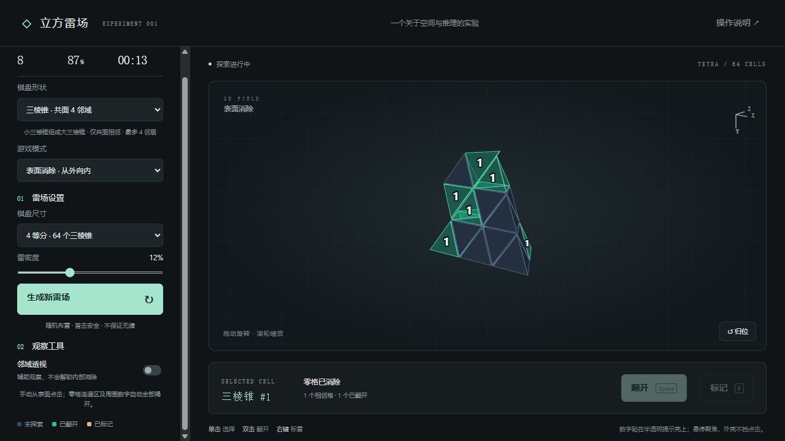

# 3Dmine · 立体扫雷

一个可以旋转、透视和逐层探索的三维扫雷实验。使用原生 JavaScript 和 Canvas 2D 绘制三维几何，**无需安装依赖，可离线运行**。

当前版本：**v0.1.0** · MIT License



## 下载后直接玩

1. 下载版本 ZIP，或在仓库页面选择 **Code → Download ZIP**。
2. **先解压整个文件夹**，不要在压缩包预览中运行。
3. 使用桌面浏览器打开文件夹里的 `index.html`。

所有资源均包含在项目中，不需要联网、登录或安装游戏引擎。

## 操作

- **鼠标拖动**：旋转整个棋盘。
- **滚轮**：缩放。
- **单击**：选择一个格子。
- **双击 / 空格**：揭开选中的格子。
- **右键 / F**：标记或取消标记地雷。
- **悬停数字**：突出当前数字格，闪烁高亮相邻的实体块，其他数字提示淡出。
- **归位**：恢复默认视角。

修改尺寸与雷密度后，点击“生成新雷场”生效。切换棋盘形状或操作模式会重新开始一局。

## 棋盘与规则

### 三棱锥（默认）

小三棱锥填满一个大三棱锥。**仅共面才算相邻，每格最多 4 个邻居**。每条边 n 等分，对应 n³ 格；单元体积相等，形状不全相同。

### 立方体

小立方体组成一个大立方体。**共面、共棱、共顶点均算相邻，内部格最多 26 个邻居**。

### 两种操作模式

- **表面消除**：手动揭开、标雷只能操作暴露于外界的实体格。安全格揭开后，便可接触更深处的格子。
- **自由探索**：允许直接操作内部格子，可按 X / Y / Z 轴切层查看。

### 数字与自动展开

- 每个安全格的数字，表示它在当前邻接规则下的相邻雷数。
- 点击零格，会完整展开连通的零格区域及其周围数字格，包括内部格子；自动展开不受手动表面限制，但会保留已标记格。
- 零格实体直接消失。数字格留下**青绿色半透明提示壳**，数字贴在朝向玩家的可见面上；未知格为深蓝色。
- 提示壳不阻挡点击后方实体，数字本身可被选择、悬停。
- 邻域透视帮助查看空间关系，不泄露隐藏雷，也不会解除手动操作限制。

首次揭开时随机布雷，并避开首击格。**首击安全，但随机布局不保证无需猜测，也不保证表面模式下每局都能完成。** 揭开全部安全格即获胜，踩雷结束。

## 本地开发（可选）

安装 Node.js 22 或更新版本后，在项目目录运行：

```sh
npm start
```

浏览器访问 `http://127.0.0.1:4173/`。此服务仅监听本机；按 Ctrl+C 停止。如果端口已被占用，先关闭之前启动的预览服务。

不需要运行 `npm install`，项目没有第三方依赖。也可直接运行：

```sh
node server.cjs
```

## 检查

```sh
npm run check
npm test
```

测试涵盖立方体规则、随机棋盘、首击安全、标雷、胜负判定、表面访问限制、固定种子雷局的完整零区展开，以及三棱锥体积、边界、连通性和共面邻接。

## 文件说明

- `core.js`：独立的棋盘与规则逻辑，不依赖浏览器。
- `app.js`：三维投影绘制、数字提示壳和交互。
- `index.html` / `style.css`：中文界面及样式。
- `server.cjs`：可选的本地预览服务。
- `test-core.cjs`：规则测试。
- `assets/preview.png`：当前版本截图。

这是用于验证玩法的 Demo。后续可将坐标、邻接、布雷、展开与胜负判定的设计迁移到 Unreal Engine 等引擎。

## 参与和许可

欢迎反馈问题、提出玩法建议或提交改进。报告问题时请附上棋盘形状、尺寸、雷密度、操作模式及复现步骤；重新开局会生成不同的随机布局。

本项目采用 [MIT 许可证](LICENSE)，允许使用、修改和再发布，包括商业用途；再发布时保留许可证及版权声明。完整条款以 `LICENSE` 文件为准。